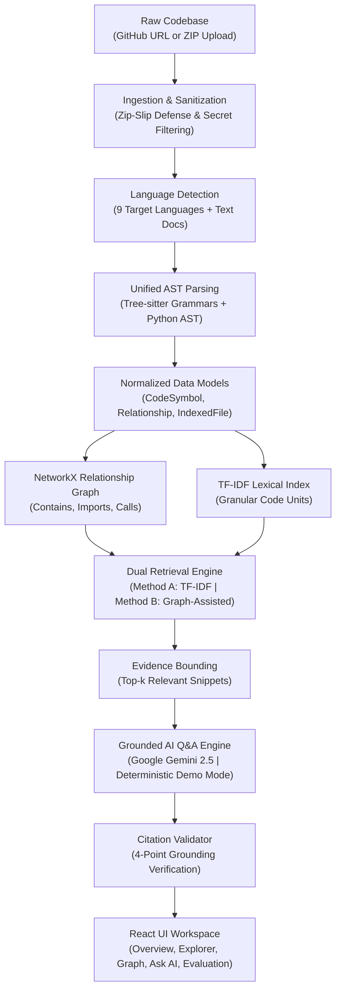
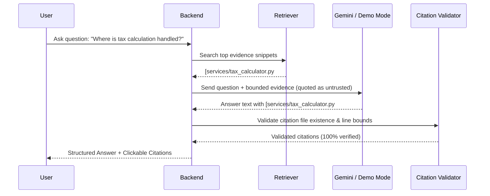

# TraceBench Architecture Document

## 1. System Overview

**TraceBench** is an evidence-grounded multi-language AI code repository investigator. It enables software engineers, students, and interviewers to analyze unfamiliar codebases by extracting verifiable syntax structures, constructing relationship graphs, executing comparative retrieval algorithms, and generating natural-language answers backed by clickable file and line citations.



---

## 2. Module Boundaries & Responsibilities

The TraceBench backend is organized into decoupled, single-responsibility modules:

| Module | Location | Primary Responsibilities |
|---|---|---|
| **API** | `backend/app/api/` | HTTP request routing, validation via Pydantic schemas, error handling. |
| **Ingestion** | `backend/app/ingestion/` | GitHub archive download, safe ZIP extraction, path traversal defense, resource quota enforcement. |
| **Languages** | `backend/app/languages/` | Extension mapping, language classification, capability matrix registry. |
| **Parsers** | `backend/app/parsers/` | Tree-sitter and AST parsing engines extracting functions, methods, classes, structs, interfaces, imports, and calls. |
| **Analysis** | `backend/app/analysis/` | Repository traversal, text extraction, symbol normalization, language statistics. |
| **Graph** | `backend/app/graph/` | NetworkX DiGraph creation, call resolution heuristics, bounded neighborhood traversal. |
| **Retrieval** | `backend/app/retrieval/` | TF-IDF lexical retrieval baseline and Graph-Assisted neighbor re-ranking. |
| **AI** | `backend/app/ai/` | Google Gen AI SDK integration, system prompts, untrusted data boundary, deterministic Demo Mode. |
| **Citations** | `backend/app/citations/` | 4-point citation validation against indexed line ranges and files. |
| **Evaluation** | `backend/app/evaluation/` | Benchmark execution, Recall@5, MRR, latency, per-language and per-question metric computation. |
| **Storage** | `backend/app/storage/` | In-memory session registry and local workspace disk caching. |

---

## 3. Data Model & Normalization

All extracted syntax structures are normalized into language-agnostic data models:

### `CodeSymbol`
- `id`: Stable unique identifier formatted as `{repo_id}:{file_path}:{name}:{start_line}`.
- `name`: Symbol identifier (e.g. `calculate_tax` or `OrderService.process_order`).
- `symbol_type`: Normalized category: `function`, `async_function`, `method`, `class`, `interface`, `struct`, `module`.
- `file_path`: Repository-relative POSIX path.
- `start_line` / `end_line`: 1-indexed source line spans.
- `parent_id`: Parent container identifier (e.g. enclosing class).
- `docstring` / `signature`: Extracted documentation and parameter signature.

### `Relationship`
- `source_id`: Source node identifier.
- `target_id`: Target node or resolved symbol identifier.
- `relationship_type`: `contains`, `imports`, `includes`, `calls`, `inferred_calls`, `references`.
- `provenance`: Originating parser engine (`python_ast`, `tree_sitter`, `symbol_resolution_inference`).
- `confidence`: Calibrated float between 0.0 and 1.0.
- `is_inferred`: Boolean distinguishing confirmed syntax from heuristic inferences.

---

## 4. Multi-Language Parser Architecture

TraceBench implements a common `BaseParser` interface:

```python
class BaseParser:
    def parse(self, file_path: str, source_code: str, repo_id: str) -> ParseResult: ...
```

### Parser Selection Logic:
1. **Python**: Parsed via Python standard library `ast` for high-fidelity docstring and decorator capture. If syntax errors occur (e.g. Python version mismatches), falls back to Tree-sitter.
2. **JavaScript / TypeScript**: Parsed via Tree-sitter grammars (`javascript`, `typescript`). Extracts classes, interfaces, arrow functions, ES imports, and calls.
3. **Java**: Parsed via Tree-sitter `java`. Extracts classes, interfaces, constructors, methods, package imports, and method invocations.
4. **C / C++**: Parsed via Tree-sitter `c` and `cpp`. Extracts functions, struct/class specifiers, preprocessor `#include` directives, and function calls.
5. **Go**: Parsed via Tree-sitter `go`. Extracts functions, methods with receiver types (`(s *Server) Start()`), struct types, and imports.
6. **Rust**: Parsed via Tree-sitter `rust`. Extracts functions, structs, traits, `impl` blocks, and `use` statements.
7. **PHP**: Parsed via Tree-sitter `php`. Extracts namespaces, classes, methods, functions, and `use` declarations.
8. **Text / Docs Fallback**: Markdown, JSON, YAML, HTML, CSS, SQL, and unsupported files are safely indexed for lexical search with zero structural errors.

---

## 5. Unified Relationship Graph Architecture

Built using `networkx.DiGraph`. 

```mermaid
graph LR
    F["File Node\n(e.g. services/order_service.py)"] -->|contains| C["Class Node\n(OrderService)"]
    C -->|contains| M["Method Node\n(process_order)"]
    M -->|calls (inferred)| T["Function Node\n(calculate_tax)"]
    F -->|imports| TF["File Node\n(services/tax_calculator.py)"]
    TF -->|contains| T
```

### Call Graph Resolution Strategy:
Static call resolution is subject to undecidability due to dynamic dispatch, duck typing, and aliasing. TraceBench adheres to strict honesty:
1. **Same-File Resolution**: If callee matches a symbol in the same file, edge is created with `confidence = 0.90`.
2. **Explicit Import Resolution**: If callee matches a symbol in an imported module/file, edge is created with `confidence = 0.85`.
3. **Repository-Wide Unique Match**: If callee name uniquely matches exactly one symbol across the entire repo, edge is created with `confidence = 0.75` and marked `is_inferred = True`.
4. **Ambiguous / Unresolved**: If multiple candidates exist or symbol is external, edge is assigned low confidence or marked unresolved.

---

## 6. Retrieval Engine

TraceBench implements two comparable retrieval methods:

### Method A: TF-IDF Lexical Baseline
- Scikit-learn `TfidfVectorizer` with sublinear TF scaling and code-friendly token pattern `(?u)\b[a-zA-Z_][a-zA-Z0-9_]*\b`.
- Documents indexed include both granular symbols (functions, methods, classes with docstrings) and file-level summaries.
- Cosine similarity ranking.

### Method B: Graph-Assisted Retrieval
- Fetches top lexical candidates from TF-IDF.
- Traverses 1-hop and 2-hop graph neighbors in NetworkX (containing classes, imported modules, called functions).
- Computes graph reinforcement score:
  $$\text{Score}_{\text{final}} = 0.70 \times \text{Score}_{\text{lexical}} + 0.30 \times \text{Score}_{\text{graph\_boost}}$$
- Returns identical response schema with detailed `graph_signals` metadata.

---

## 7. Evidence-Grounded AI & Citation Validation



### 4-Point Citation Validation Checklist:
1. **Repository Match**: Citation belongs to active repository ID.
2. **File Existence**: File path exists in indexed files.
3. **Valid Line Bounds**: $1 \le \text{start\_line} \le \text{end\_line} \le \text{total\_lines}$.
4. **Evidence Overlap**: Verified against retrieved evidence snippets or indexed symbols.
